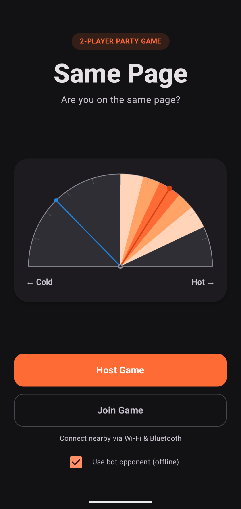

# Same Page

Same Page is a two-player Android game in which one player sees a hidden target on a spectrum between two extremes (e.g., "Hot" and "Cold"), writes a clue, and the other player guesses the position based on that clue. 

<p align="center">
  
</p>

You can connect over local Wi-Fi and Bluetooth using Google Nearby Connections. So, ultimately no internet connection is required, enabling you to play in contexts where you have no (or a poor) data connection (e.g., subway rides). In fact, I created this app explicitly so my wife and I can play together on the subway.

## How to Play

Each round, one player is the "**psychic**" and the other is the "**guesser**".

1. The **psychic** sees a spectrum card (e.g., "Old ↔ Young") and a target position hidden somewhere on that spectrum.
2. The **psychic** writes a single-word clue hinting at where the target sits.
3. The **guesser** reads the clue, sees the spectrum endpoints, and drags a needle to their best guess.
4. Both players see the reveal together: how close the guess landed and the points earned.

Player roles alternate across 6 rounds. Guesses closer to the target yield more points, according to the following table.

| Zone | Distance from target | Points |
|------|---------------------|--------|
| Bullseye | within 4% | 4 |
| Inner | within 10% | 3 |
| Outer | within 18% | 2 |
| Miss | beyond 18% | 0 |

The maximum possible score across all 6 rounds is 24.

## Getting Started

You need two Android phones, generally speaking. One player taps **Host Game**, the other taps **Join Game**. Both devices need Wi-Fi or Bluetooth turned on; no accounts or server setup required.

There's also a built-in bot opponent available for solo testing (both as host and has the client). You can toggle it with the checkbox on the home screen.

## Build

Requires Android Studio and JDK 17.

```
git clone <your-repo-url>
```

Open the project in Android Studio and run the `app` configuration on a device or emulator running API 26+.

## Tech

- Kotlin + Jetpack Compose + Material 3
- Google Nearby Connections (peer-to-peer over Wi-Fi and Bluetooth)
- kotlinx.serialization for message encoding between devices
- Single-activity architecture with Compose Navigation
- MVI-style game state: pure reducer in `GameEngine`, single `GameViewModel`

## Project Layout

```
app/src/main/java/com/wavelength/
├── game/           # State, actions, reducer, scoring
├── net/            # ConnectionManager interface, NearbyConnectionManager, FakeConnectionManager (bot)
├── data/           # SpectrumRepository — loads cards from assets/spectrums.json
├── ui/
│   ├── screens/    # Home, Lobby, Clue, Round, Reveal, Results
│   ├── components/ # SpectrumDial, SpectrumLabel
│   ├── navigation/ # NavGraph, route definitions
│   ├── viewmodel/  # GameViewModel
│   └── theme/      # Colors and theming
└── MainActivity.kt
```

## Status

Early development. Playable with two devices over Nearby Connections, or solo against the bot.
